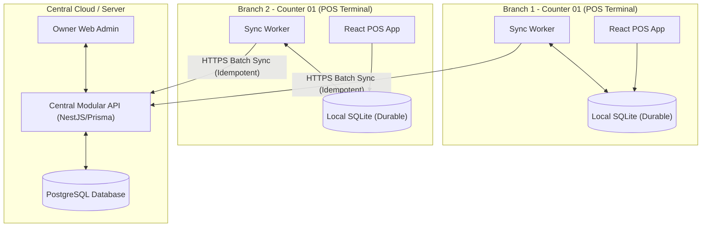
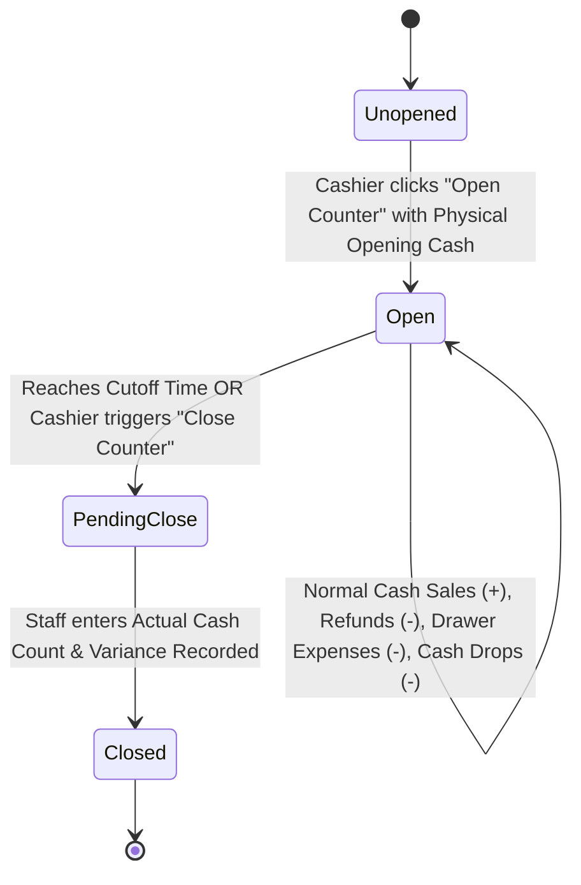
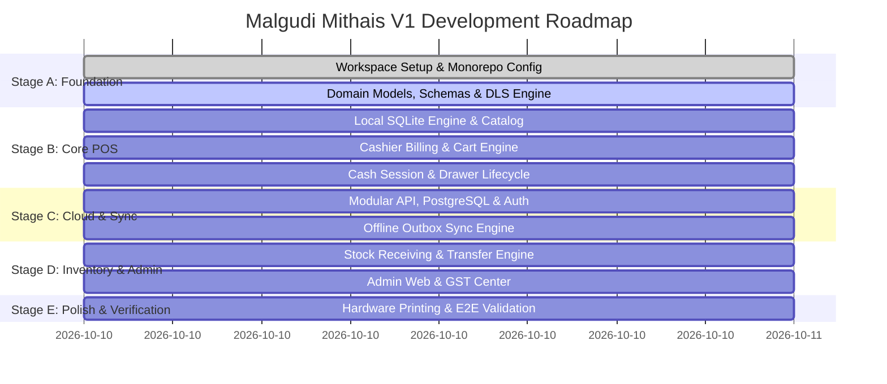

# Malgudi Mithais — Architecture & UX Blueprint
**Multi-Branch Retail POS & Business Management System**  
*Madurai, Tamil Nadu, India*

---

## 1. Executive Summary & Product Vision

Malgudi Mithais is a premier retail sweets, savouries, snacks, and bakery brand operating in Madurai, Tamil Nadu (starting with 2 branches, designed for infinite branch scale). As a pure retail business, Malgudi Mithais receives finished goods from an upstream central production facility or external suppliers and sells them across high-velocity retail counters.

### Core Philosophy
> **"Powerful underneath. Lean on the surface."**

The system is designed for operational calm and extreme reliability:
1. **Zero Cash Fabrications**: Drawer balances reflect real counted currency; automatic day-end routines never guess or fabricate cash.
2. **Deterministic Inventory**: Stock deductions and receipts operate as immutable ledger movements tied to sales and receipts.
3. **Shared Counter Ergonomics**: Counter staff work on shared physical terminals without intrusive login barriers, while sensitive actions require supervisor authorization.
4. **Offline Resilience**: Local SQLite guarantees that retail counters ring sales, record cash, and print receipts even during internet outages, syncing seamlessly when connectivity restores.
5. **GST & CA Readiness**: Instant HSN summaries, CGST/SGST breakdowns, and monthly accountant exports for Tamil Nadu (State Code 33).

---

## 2. Environment & Runtime Inspection

| Property | Detected / Confirmed Value | Impact & Design Decision |
|---|---|---|
| **OS** | Windows 11 / Windows PowerShell | Target desktop platform is Windows. Native printing (USB thermal 80mm / ESC/POS) & local device access supported. |
| **Node.js** | `v24.12.0` | Latest LTS Node runtime with native ESM and top-level await. |
| **pnpm** | `10.28.0` | Modern, high-performance monorepo workspace package manager. |
| **Git** | `2.52.0.windows.1` | Version control active. |
| **Rust / Cargo** | Not pre-installed in PATH | POS client runs as a high-performance desktop web application (Vite + React + TypeScript + SQLite via WA-SQLite/OPFS persistent storage & standalone desktop executable compatibility). Tauri scaffolding provided so it can be natively compiled once Cargo is added. |
| **Existing Code** | Empty directory (`initialprompt.md` only) | Clean slate. No legacy baggage; full clean architecture implementation. |

---

## 3. Monorepo Repository Structure

The system is structured as a modular monorepo using `pnpm` workspaces:

```
pos-billing/
├── apps/
│   ├── pos/                    # High-speed Retail Counter Desktop Application (React 19 + Vite + TS)
│   ├── admin/                  # Owner & Manager Central Web Backoffice (React 19 + Vite + TS)
│   └── api/                    # Central Modular Monolith Backend (NestJS / Node Express + Prisma)
├── packages/
│   ├── domain/                 # Pure TypeScript business models, state machines & calculation engines
│   ├── contracts/              # Shared DTOs, API contracts & sync protocol interfaces
│   ├── validation/             # Zod validation schemas shared across client & backend
│   ├── dls/                    # Malgudi Design Language System (Tailwind tokens, components, icons)
│   ├── hardware/               # Thermal printer (ESC/POS 80mm), Barcode scanner, Weight scale adapters
│   ├── sync-engine/            # Offline-first SQLite queue, idempotency keys, retry backoff & resolver
│   └── config/                 # Shared TypeScript configurations (eslint, tsconfig, constants)
├── prisma/                     # Central PostgreSQL schema, migrations, seed data
├── docs/                       # Blueprints, operational guides, hardware specs
└── pnpm-workspace.yaml
```

---

## 4. Domain Entities & Database Design

### 4.1 Dual-Database Topology
- **Local Operational Database (Client)**: SQLite running in the POS client (via durable VFS / WA-SQLite with OPFS persistence). Each POS terminal possesses its own private SQLite database containing local catalog caches, counter sessions, sales, cash movements, and an outbox synchronization queue.
- **Central Database (Server)**: PostgreSQL (hosted on Neon Free tier or self-hosted) accessed via Prisma ORM by the central API service.



### 4.2 Core Domain Models & Schemas

#### 1. Organization & Multi-Branch Hierarchy
- `Organization`: ID, name (`Malgudi Mithais`), GSTIN, legal address, phone, settings.
- `Branch`: ID, org_id, code (`IB` for Iyer Bungalow, `KK` for KK Nagar), name, address, phone, GSTIN (inherits or distinct), default business day cutoff (default `23:59`), status (`ACTIVE`).
- `Counter`: ID, branch_id, code (`C1`, `C2`), name, default_cash_drawer_policy (`DEDICATED` | `SHARED_DRAWER`), status.
- `Device`: ID, counter_id, hardware_fingerprint, token_hash, last_synced_at.

#### 2. Users, Roles & Shared Counter
- `User`: ID, username, display_name, role (`OWNER`, `MANAGER`, `CASHIER`), pin_hash (for supervisor approvals), is_active.
- **Shared Counter Model**: A counter session belongs to `(Branch, Counter)`. Cashiers operate the counter without frequent credential switching. Transactions record `opened_by_user_id` (optional), `closed_by_user_id`, and `authorized_by_user_id` when sensitive operations occur (e.g., discounts > threshold, manual item void, large cash removal).

#### 3. Product Catalog & Selling Configurations
- `Category`: ID, name (e.g., `Traditional Sweets`, `Ghee Sweets`, `Savouries / Kaaram`, `Bakery & Cakes`, `Beverages`), display_order.
- `Product`:
  - `id`, `name` (English), `tamil_name` (optional Tamil label e.g., "நெய் மைசூர் பாக்"), `category_id`, `sku`, `barcode`.
  - `inventory_unit`: `KG`, `GRAM`, `PIECE`, `PACK`, `BOX`, `DOZEN`.
  - `selling_mode`:
    - `WEIGHT_BASED`: Sold in grams or kilograms (loose Mysore Pak, Halwa, Mixture).
    - `UNIT_BASED`: Sold per piece (Puffs, Samosa, Bun, Bread).
    - `FIXED_PACK`: Packaged pre-weighed items (e.g. 250g Omapodi pack, 500g Sweet Box).
  - `tax_rate`: `0%`, `5%`, `12%`, `18%`.
  - `hsn_code`: (e.g., `2106` for sweets/savouries, `1905` for bakery).
  - `low_stock_threshold`: Float quantity.
  - `base_cost_price`, `selling_price_per_unit`.

#### 4. Retail Inventory & Stock Ledger
- **No Recipes / No Manufacturing**: Goods arrive finished.
- `StockMovement` (Immutable Ledger):
  - `id`, `branch_id`, `product_id`, `movement_type`:
    - `OPENING_STOCK`
    - `RECEIPT_PRODUCTION` (From central production unit)
    - `RECEIPT_SUPPLIER` (From external vendor)
    - `SALE_DEDUCTION` (Automatic upon completed sale)
    - `TRANSFER_OUT` / `TRANSFER_IN`
    - `CUSTOMER_RETURN` (Only if disposition = `RESTOCK`)
    - `WASTAGE_DAMAGE` / `WASTAGE_EXPIRED`
    - `MANUAL_ADJUSTMENT` (Requires manager PIN + reason)
  - `quantity`: Signed float (positive for incoming, negative for deduction).
  - `unit`: Base inventory unit.
  - `reference_id`: Points to `SaleID`, `StockReceiptID`, `TransferID`, etc.
  - `batch_or_received_date`: Date.
  - `created_at`, `created_by`.
- `StockBalance`: Cached projection per `(branch_id, product_id)` kept synchronized via transaction triggers/hooks.

#### 5. Counter Sessions & Cash Management (The Golden Lifecycle)


- `CounterSession`:
  - `id` (UUIDv7)
  - `branch_id`, `counter_id`
  - `business_date`: YYYY-MM-DD
  - `opened_at`, `opened_by` (optional cashier name)
  - `opening_cash`: Decimal
  - `status`: `OPEN` | `PENDING_CLOSE` | `CLOSED`
  - `expected_cash`: Calculated drawer balance
  - `actual_cash`: Real physical count entered by human
  - `cash_difference`: `actual_cash - expected_cash`
  - `closing_notes`, `closed_at`, `closed_by`, `supervisor_approved_by`
- `CashMovement`:
  - `id`, `session_id`, `branch_id`, `movement_type`:
    - `OPENING_FLOAT`
    - `CASH_SALE`
    - `CASH_REFUND`
    - `DRAWER_EXPENSE` (Tea/milk, local courier, counter supplies)
    - `CASH_DROP` (Mid-day deposit into safe/owner handover)
    - `CASH_ADDITION` (Change added to drawer)
    - `AUTHORIZED_CORRECTION`
  - `amount`: Positive decimal
  - `direction`: `IN` or `OUT`
  - `reference_id`, `reason`, `created_at`, `created_by`

> **Rule 1: Drawer Expected Cash Formula**  
> `Expected Cash = Opening Cash + Cash Inflows - Cash Outflows`  
> Non-cash transactions (UPI, Card, Credit) are tracked under `SalePayment`, but **NEVER** enter the physical cash drawer tally.

> **Rule 2: Zero Cash Fabrication**  
> If day-end cut-off occurs while a session is open, the system marks the session as `PENDING_CLOSE` and flags `Cash Count Required`. It will **never** fill `actual_cash = expected_cash`.

#### 6. Sales, Payments & Billing
- `Sale`:
  - `id` (Client-generated UUIDv7), `local_invoice_number` (`IB-261010-0001`), `central_invoice_number`
  - `branch_id`, `counter_id`, `session_id`, `business_date`
  - `subtotal_amount`, `discount_amount`, `tax_amount` (CGST + SGST), `round_off`, `total_amount`
  - `status`: `COMPLETED` | `CANCELLED` | `RETURNED_PARTIAL` | `RETURNED_FULL`
  - `payment_status`: `PAID` | `PARTIALLY_PAID` | `REFUNDED`
  - `customer_id` (optional)
  - `created_at`, `synced_at`
- `SaleItem`:
  - `id`, `sale_id`, `product_id`, `selling_mode`
  - `unit_price`, `quantity`, `unit`, `discount_amount`, `tax_rate`, `cgst_amount`, `sgst_amount`, `total_amount`
- `SalePayment`:
  - `id`, `sale_id`, `payment_method` (`CASH` | `UPI_RECORDED` | `UPI_GATEWAY` | `CARD`), `amount`, `reference_notes`, `status` (`SUCCESS` | `REFUNDED`)

#### 7. Returns, Cancellations & Refunds
- `ReturnOrder`:
  - `id`, `original_sale_id`, `branch_id`, `session_id`, `reason`, `authorized_by`
  - `refund_amount`, `refund_method` (`CASH` | `UPI`)
  - `return_items`: List of `(product_id, quantity, return_disposition)`
  - `return_disposition`: `RESTOCK` (returns to sellable inventory) or `SCRAP_WASTAGE` (does not increment sellable stock)

#### 8. Purchases & Supplier Goods Receipt
- `Supplier`: ID, name, contact_person, phone, GSTIN, city, state.
- `StockReceipt`:
  - `id`, `branch_id`, `source_type` (`CENTRAL_PRODUCTION` | `EXTERNAL_SUPPLIER` | `BRANCH_TRANSFER`)
  - `supplier_id` (if external), `source_branch_id` (if transfer)
  - `invoice_or_dc_number`, `invoice_date`, `received_date`
  - `status`: `DRAFT` | `CONFIRMED`
  - `items`: List of `(product_id, received_qty, unit, unit_cost, tax_rate)`
  - *Invariant*: Stock ledger updates **only** upon `CONFIRMED`.

#### 9. GST Center & Compliance
- State: Tamil Nadu (`State Code: 33`).
- All sales classify as B2C (unregistered consumer) or B2B (with customer GSTIN).
- Rates: 0% (unbranded fresh staples), 5% (sweets, savouries, namkeen), 12% / 18% (bakery, chocolates, beverages).
- Exports: GSTR-1 formatted B2B, B2C Large, B2C Small, HSN Summary CSV/Excel.

---

## 5. Offline-First Synchronization Architecture

Each POS client operates with complete autonomous integrity:

```
[UI Actions: Billing, Cash, Receiving]
          │
          ▼
   [Local SQLite DB] ──(Atomic Transaction)──► Write Record & Enqueue Sync Event
          │                                           │
          │                                           ▼
          │                                 [Sync Outbox Queue]
          │                                           │
          │                                           ▼
          │                                  [Sync Worker Loop]
          │                                           │ (Internet Available?)
          │                                           ├─► No: Sleep with exp-backoff
          │                                           └─► Yes: POST /api/v1/sync/push
          │                                                    │
          │                                                    ▼
          │                                            [Server Validates]
          │                                         (Idempotent Check by UUID)
          │                                                    │
          ▼                                                    ▼
[Local Projection Updated] ◄── Server Ack & Pull Delta ── [PostgreSQL Database]
```

### Invariants for Sync
1. **UUIDv7 Primary Keys**: All client transactions receive timestamp-sortable UUIDv7 identifiers created locally.
2. **Idempotency Guarantee**: The central API enforces unique constraints on entity IDs and sync operations. Retrying a sync packet never duplicates sales or stock adjustments.
3. **No Overwrites of Newer Cloud Data**: Catalog and price updates from cloud are merged by monotonic `updated_at` / version tags.
4. **Resilience to Restart**: The outbox queue resides in durable SQLite, surviving client restarts, power cuts, and crashes.

---

## 6. Malgudi Design Language System (DLS)

A custom, culturally grounded design language built specifically for high-velocity sweet shops:

### Color System
- **Malgudi Maroon (Primary)**: `#8B1E2D` (Primary brand action, prominent billing trigger)
- **Primary Dark**: `#6F1623` (Pressed/active states)
- **Primary Light**: `#F4DDE1` (Focus rings, soft badges)
- **Primary Soft**: `#FBF1F3` (Selected table row backgrounds)
- **Heritage Cream**: `#FFF9F0` (Counter panels, bill header highlights)
- **App Canvas**: `#F7F7F5` (High-legibility glare-free background)
- **Surface Clean**: `#FFFFFF` (Card surfaces, active modal sheets)
- **Subtle Surface**: `#FCFCFA` (Table alternating stripes, search inputs)
- **Text Heavy**: `#1F1F1F` (95% contrast readability for cashiers)
- **Text Secondary**: `#666666` (Labels, metadata, timestamps)
- **Border Crisp**: `#E5E1DC` (Sharp POS grid partitions)
- **Emerald Success**: `#16835B` / `#E8F5EF` (Paid status, in-stock pills, balanced drawer)
- **Amber Warning**: `#C77B00` / `#FFF4DE` (Pending close, low stock, cash shortage)
- **Crimson Error**: `#C62828` / `#FDECEC` (Stock depleted, cash discrepancy, printer disconnected)
- **Sapphire Info**: `#2563A8` / `#EAF2FB` (Sync pending, transferred goods)

### Typography & Ergonomics
- Clean modern sans-serif (`Inter` or system UI font) with high optical sizing for numbers.
- Large touch-friendly and keyboard-accessible buttons (`Enter` to pay, `F2` to search, `Esc` to clear).
- Native Tamil script support for product names (`font-family: 'Mukta Malar', 'Inter', sans-serif`).

---

## 7. Hardware Abstraction Layer

1. **80mm Thermal Printer**:
   - Standard ESC/POS command generator.
   - Outputs: Shop Header (Tamil & English), Branch Info, GSTIN, Bill No, Time, Itemized Table with Rate & HSN, Subtotal, CGST+SGST, Round-off, Grand Total, Tendered Cash & Change, Footer message.
   - Provides web-native ESC/POS raw printing and Windows print dialog fallback.
   - "Print Again" / Reprint functionality never creates duplicate sales.
2. **Barcode Scanner**:
   - Universal USB keyboard wedge listener. Auto-detects fast keystroke bursts (>30 chars/sec terminating in `Enter`) and adds products directly to cart without requiring cursor focus in the search box.
3. **Electronic Weighing Scale**:
   - Serial/USB port reader (RS-232 / Web Serial API).
   - If connected and calibrated, captures live gram weight; provides manual weight entry input with immediate validation fallback when scale is offline.

---

## 8. Implementation Stages & Roadmap



- **Stage A**: Workspace scaffolding (`pnpm-workspace.yaml`, packages, shared contracts, DLS styling tokens).
- **Stage B**: Core POS desktop application (Product Catalog, Weighted & Pack billing, Cart, Payment modal, Receipt generator, Open/Close Counter session manager).
- **Stage C**: Modular Monolith API (Branch management, PostgreSQL schema via Prisma, sync endpoints, idempotent receivers).
- **Stage D**: Finished goods receiving ("Receive Stock" workflow), multi-branch inventory ledger, branch transfers, returns/refunds, GST reports.
- **Stage E**: Admin backoffice dashboard ("Business Pulse", "Since Your Last Visit", Cash closing monitor, GST Excel/CSV exports), hardware integration, E2E tests and packaging.

---

## 9. Non-Functional, Security & Compliance Guarantees

1. **No Floating Point Financial Math**: All currency calculations use integer paise or decimal-safe math (`100.50` = `10050` paise) with rounding to the nearest rupee only at final bill tender.
2. **Branch Authorization**: Every server request validates branch tokens; no cashier from Branch 1 can query or mutate Branch 2's cash session.
3. **Traceability**: Every stock deduction has an unbroken ledger trail back to a sale ID, receipt invoice, or authorized adjustment record with supervisor ID.
4. **Data Portability**: Full SQLite export on device and automated PostgreSQL daily dump script with Zero-Cost cloud compatibility (Neon + Render).
